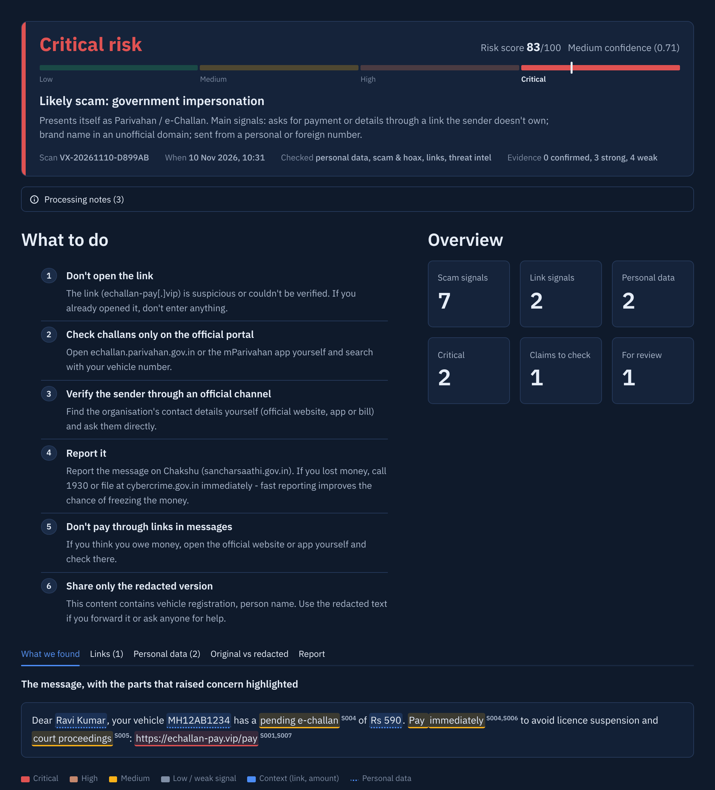
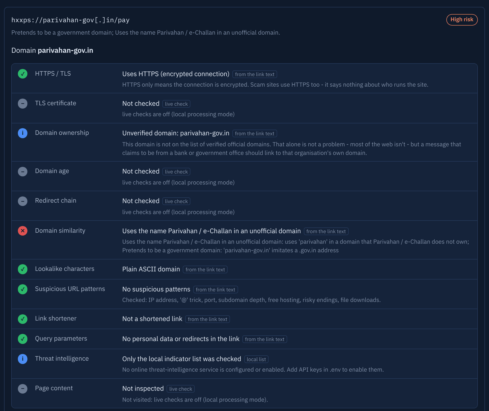
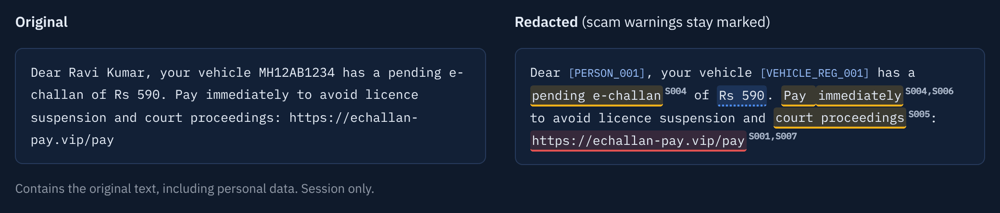
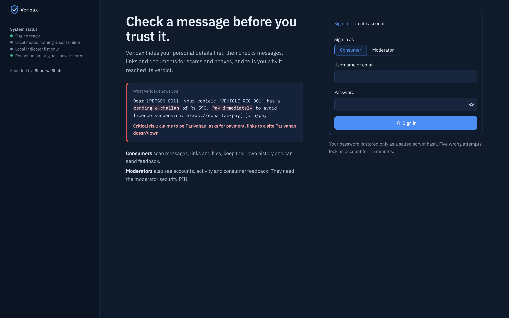
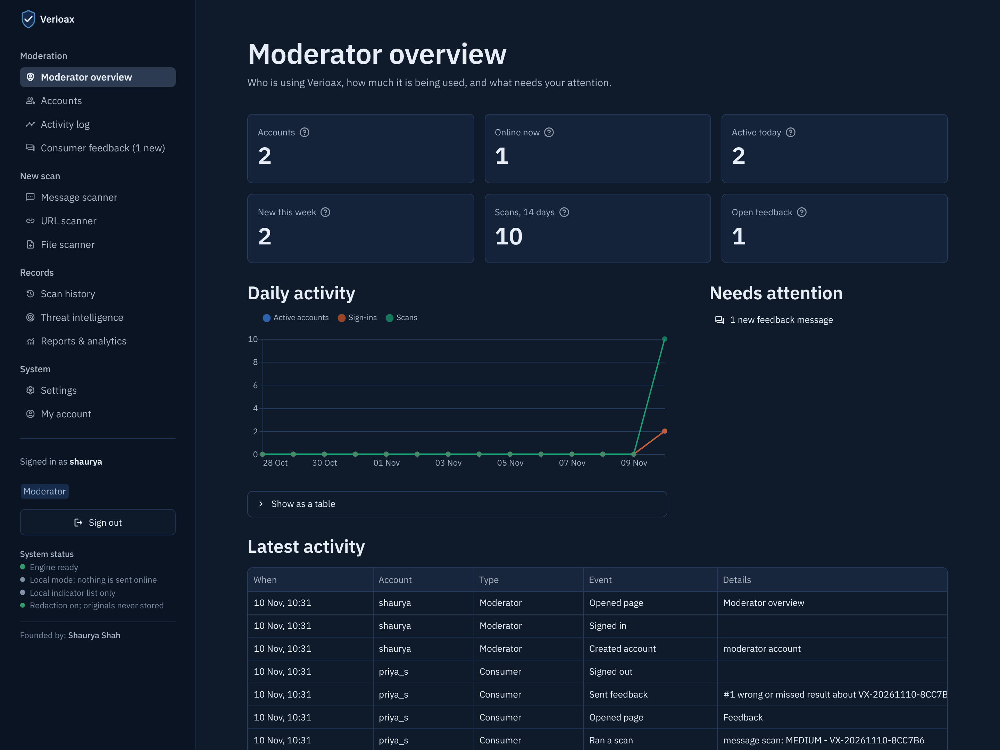
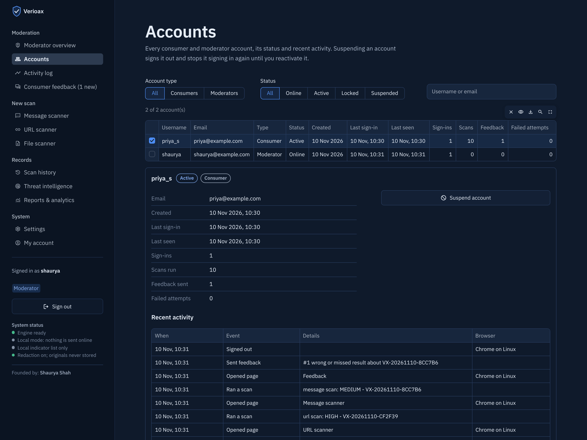
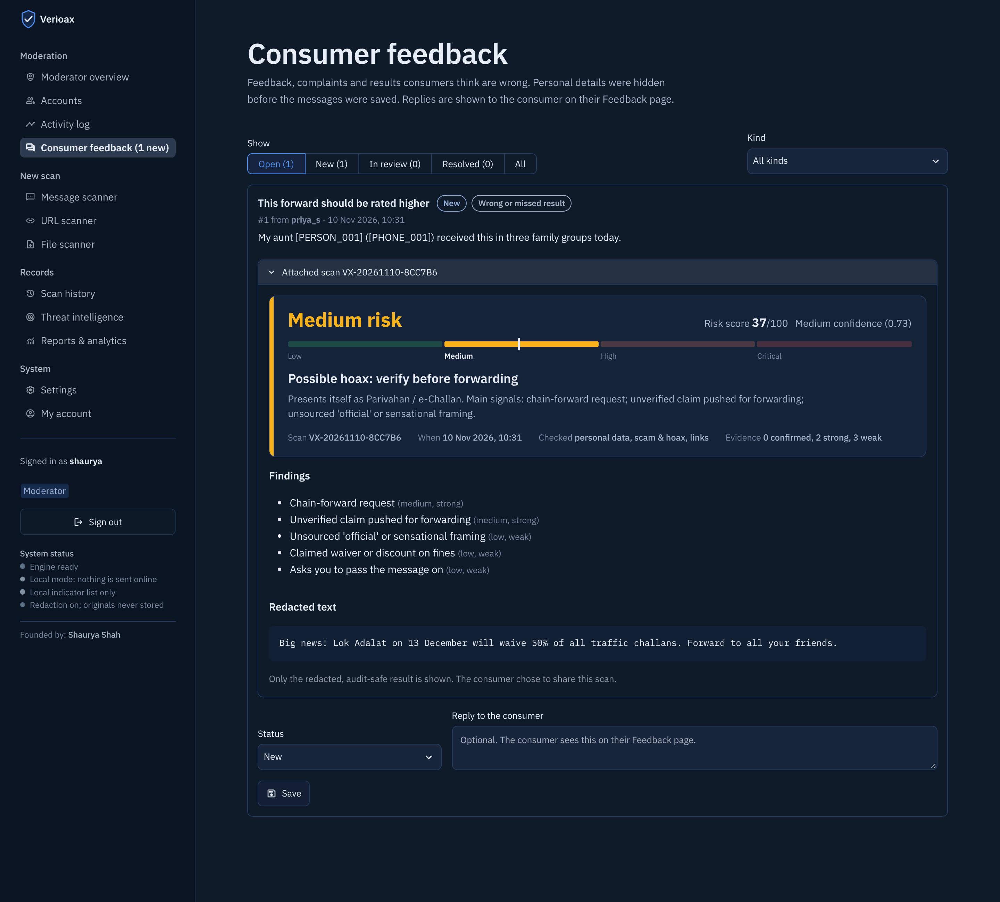
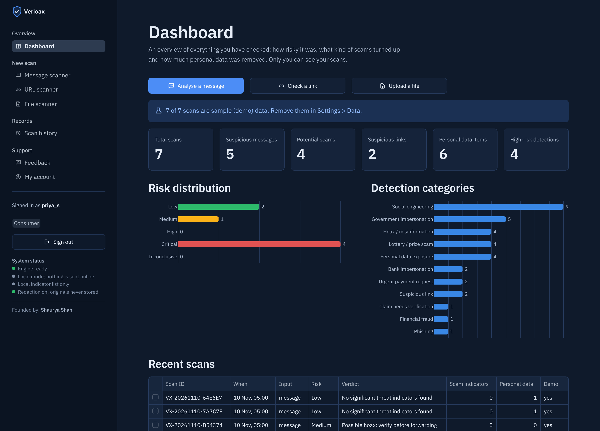

# Verioax

**Intelligent message, link & privacy protection.** Paste a suspicious SMS, WhatsApp message, email, link or document.
Verioax removes your personal data first, then checks the content for scam and hoax signals, inspects every link, and
explains its verdict in plain language: what it found, where, how sure it is, and what to do next.

People sign in as **consumers**, who scan things and keep their own private history, or as **moderators**. Moderators
also see accounts, traffic, the activity log and consumer feedback, and they need a moderator security PIN to sign in.



## The problem

In December 2025, Cyble's research team documented **more than 36 phishing domains imitating India's e-Challan
service**. The SMS warns of an unpaid traffic fine (₹590 in their example) and threatens licence suspension and court
action. It links to a lookalike portal that shows a fabricated challan, then collects the card number, CVV and expiry on a
fake payment page. ([Cyble](https://cyble.com/blog/rto-scam-wave-continues/))
This is one campaign among many. India recorded **28.15 lakh cybercrime cases in 2025**, and victims lost at least
**₹22,495 crore**. ([ThePrint, MHA data](https://theprint.in/india/cybercrime-saw-24-spike-in-2025-indians-lost-rs-22495-crore-mainly-in-investment-scams/2859930))

People who receive these messages have two bad options:

- They can guess from the wording.
- They can paste the whole message into a chatbot or a link checker. That also hands over their name, vehicle number and
  phone number.

Verioax does the privacy step first, gives a verdict it can explain, and never opens the link in the user's browser.

## What it does

1. **Redact.** Personal data becomes typed placeholders such as `[PERSON_001]` and `[VEHICLE_REG_001]`. Repeated values
   reuse the same placeholder, and a leak sweep re-scans the output for anything missed. Only the redacted text is ever
   stored, sent to an online service or given to the optional AI model.
2. **Analyse.** Two independent engines run:
   - The **scam & hoax engine** reads the text: who it claims to be from, what it asks for, how it pressures you, and
     whether it is a chain-forward hoax.
   - The **link engine** inspects every link. Static checks always run. Live checks (redirects, page content, certificate,
     domain age) and threat-intelligence lookups run when enabled.
3. **Explain.** You get:
   - One verdict: LOW, MEDIUM, HIGH, CRITICAL or INCONCLUSIVE.
   - A 0–100 risk score and, separately, a confidence value.
   - Every finding, with the exact text that triggered it, its severity and its evidence strength (weak, strong or
     confirmed).
   - Concrete next steps, such as checking the challan on echallan.parivahan.gov.in, reporting on Chakshu, or calling 1930
     if money was lost.

| | |
|---|---|
|  |  |
| **Link report**: every check is marked pass, warning, fail or *not checked*, and says where the result came from. | **Original vs redacted**: scam warnings stay marked in the redacted copy you can share. |

## Consumers and moderators

| | |
|---|---|
|  |  |
| **Sign in or create an account** as a consumer or a moderator. Moderators also enter the 6-digit moderator security PIN, at sign-up and at every sign-in. | **Moderator overview**: accounts, who is online, daily activity, scans, and what needs attention. |
|  |  |
| **Accounts**: every consumer and moderator with their status (online, active, locked, suspended), activity, and suspend / reactivate / unlock actions. | **Consumer feedback**: complaints and "wrong result" reports, with the scan the consumer chose to attach, a status and a reply. |

**Consumer UI**
- Dashboard, message / link / file scanners and scan history. The history shows **only your own scans**.
- **Feedback**: send feedback or a complaint to the moderators and read their replies. The **Report a wrong result**
  button on any result opens the form with that scan attached.
- **My account**: details, password change, and deleting your stored scans.

**Moderator UI**
- **Moderator overview**: traffic for the last 14 days and the items that need attention.
- **Accounts**: the status of every account, with suspend, reactivate and unlock.
- **Activity log**: sign-ins, failed attempts and wrong PINs, scans (type and verdict only), feedback and moderator
  actions, with CSV export.
- **Consumer feedback**: inbox with statuses (new, in review, resolved) and replies.
- **Platform-wide pages**: threat intelligence, analytics across everyone's scans, and settings.

Both UIs show **Founded by: Shaurya Shah** under System status in the sidebar.

## Features

**Personal-data engine**
- 15 types of personal data, including:
  - Aadhaar (Verhoeff checksum), PAN (holder-type check) and GSTIN (checksum)
  - cards (Luhn) and IBAN (mod-97)
  - vehicle registrations, including BH-series plates
  - UPI IDs, bank accounts, Indian and international phone numbers, emails, dates of birth and addresses
  - OTPs and passwords
- Names are found by rules, and by spaCy too if it is installed. Each name is propagated so every later mention is caught.
- Two-round leak sweep.
- A review queue for low-confidence findings, and clean / needs-review / blocked status.

**Scam & hoax engine**
- 36 indicators in English, Hinglish and Hindi, grouped into 15 categories (phishing, government or bank impersonation,
  digital arrest, task and job scams, prize and advance-fee fraud, investment scams, hoaxes and more).
- A claimed-identity registry of 52 Indian government bodies and schemes (PM-KISAN, Ayushman Bharat, PM Awas Yojana),
  banks, payment apps, couriers, platforms and brands often used as bait (Amul, Tata, DMart, Meesho), with their official
  domains. Restricted registries such as `gov.in`, `nic.in`, `bank.in` and `.sbi` are recognised.
- Sender analysis:
  - TRAI DLT headers such as `VM-HDFCBK-S`
  - personal mobile numbers used in the name of an organisation
  - international numbers
- Combination rules that recognise complete scam patterns. Example: *claims to be Parivahan + asks for payment + links to
  a domain Parivahan doesn't own*.
- Viral scams and hoaxes:
  - giveaways that must be forwarded to "unlock" them (anniversary gifts, spin-the-wheel, free recharges)
  - fake government-scheme offers ("PM free laptop yojana")
  - celebrity giveaways
  - fear hoaxes (kidnapping gangs, "answering this call hacks your phone")
  - widely debunked claims (GPS chips in banknotes, "WhatsApp will become paid")
  
  Fact-checks and warnings that quote a hoax are recognised and not held against the message.
- Claims worth checking before you act or forward, with how to verify each one. Optionally, they are looked up in Google
  Fact Check.

**Link engine**
- Lookalike and typosquat detection (Damerau-Levenshtein), fake government domains, homographs and punycode, `@` tricks,
  IP-address hosts, shorteners, free hosting, frequently abused TLDs, APK downloads, and personal data in query strings.
- Fake government-scheme domains (`pm-laptop-yojana.in`) and brand-giveaway domains (`amul-anniversary-gift.blogspot.com`).
- Live checks through an **SSRF-guarded fetcher**. They record the redirect chain, inspect the page, check TLS, and look up
  domain age through RDAP. The page inspection checks:
  - card or OTP forms
  - fake scheme registration forms that ask for Aadhaar or bank details
  - government branding on non-government sites
  - hidden text aimed at AI models, and APK links
  - **what the page says**: "share with 5 groups to claim your gift", prizes, hoax claims
- Threat intelligence:
  - built-in list of known scam domains (seeded with the published IOCs of the e-challan campaign)
  - Google Safe Browsing, VirusTotal, URLhaus, PhishTank and OpenPhish
  - every result is labelled *live*, *cached*, *local* or *not checked*

**Product**
- Streamlit web app with sign-in, a consumer UI and a moderator UI (see above), and:
  - a dashboard
  - message, link and file scanners (PDF, DOCX, TXT/CSV, and images through OCR)
  - searchable history
  - a threat-intelligence status page
  - analytics
  - settings
- FastAPI REST API that uses the same engine, with bearer-token auth and rate limiting. The web app can use it as its
  backend.
- Reports in PDF, Markdown, JSON and CSV. No raw personal data is included in any format.



## Quick start

Requires Python 3.10 or newer.

```bash
git clone https://github.com/<your-username>/verioax.git
cd verioax
python -m venv .venv
source .venv/bin/activate            # Windows: .venv\Scripts\activate
pip install -r requirements.txt
cp .env.example .env                 # Windows: copy .env.example .env  - then set VERIOAX_MODERATOR_PIN in .env
streamlit run app/streamlit_app.py   # opens http://localhost:8501
```

Create an account on the sign-in page. Choose **Consumer**, or **Moderator** with the PIN you put in `.env`.

**The moderator PIN is not in the code.** This repository is public, so a PIN written into it would let anyone become a
moderator. Set it in `.env` for your own computer, and as a secret on a hosting platform:
- Streamlit Community Cloud: app → Settings → Secrets → `VERIOAX_MODERATOR_PIN = "123456"`
- Render: the service's Environment

Without it, moderator sign-up and sign-in are switched off, and consumers can still use Verioax.

To try it without any data of your own, use one of these:
- **Try a sample** in the Message, URL or File scanner
- **Load sample scans** on the empty dashboard. Sample scans are labelled as demo data and can be removed in
  Settings > Data.

### REST API

```bash
uvicorn api.main:app --port 8000     # interactive docs: http://localhost:8000/docs

curl -s http://localhost:8000/v1/scan/message \
  -H "Content-Type: application/json" \
  -d '{"text": "Dear Ravi Kumar, your e-challan of Rs 590 is pending. Pay now: https://parivahan-gov.in/pay"}'
```

| Method | Path | Purpose |
|---|---|---|
| GET | `/health` | Engine status, network mode, provider states |
| POST | `/v1/scan/message` | `{text, sender?, mode?}`. `mode` is `full` (default), `scam` or `pii` |
| POST | `/v1/scan/url` | `{url}` |
| POST | `/v1/scan/file` | multipart upload (max 15 MB) |
| GET | `/v1/scans` | History, with filters: `risk`, `input_type`, `category`, `search`, `since`, `until`, `limit` |
| GET / DELETE | `/v1/scans/{id}` | One stored scan |
| GET | `/v1/scans/{id}/report.{json\|md\|csv\|pdf}` | Report download |
| GET | `/v1/analytics`, `/v1/analytics/report.{fmt}` | Aggregates and analytics report |
| GET | `/v1/intel/status` | Which threat-intelligence sources are configured and tested |
| POST | `/v1/intel/test/{provider}` | Run one test lookup |
| GET / PUT | `/v1/preferences` | Analysis and privacy settings |

To make the web app use the API instead of running the engine in-process, set `TRUSTGUARD_API_URL=http://localhost:8000`.

### Docker

```bash
cp .env.example .env                 # add any API keys you have (all optional)
docker compose up --build            # web app :8501, API :8000 - both bound to localhost only
```

### Optional extras

| Extra | Install | What it adds |
|---|---|---|
| OCR | Tesseract: `sudo apt install tesseract-ocr tesseract-ocr-hin` · macOS `brew install tesseract tesseract-lang` · Windows: the UB Mannheim installer | Reads screenshots and scanned PDF pages |
| Better name detection | `pip install spacy && python -m spacy download en_core_web_sm` | NER on top of the name rules |
| AI explanation | [Ollama](https://ollama.com) + `ollama pull llama3.1:8b`, then turn on *AI explanation* in Settings | A plain-language summary. The model gets redacted text and the findings only, and it cannot change the verdict. |

## Configuration

All settings are optional. Copy `.env.example` to `.env`. `.env` is git-ignored, so keys never get committed.

| Variable | Default | Purpose |
|---|---|---|
| `VERIOAX_MODERATOR_PIN` | empty | The 6-digit PIN moderators enter at sign-up and sign-in. Empty = no moderator access. Keep it out of the repository. |
| `TRUSTGUARD_DATA_DIR` | `data/runtime` | Scan history, accounts and activity log, lookup cache, preferences, your own indicator list |
| `TRUSTGUARD_API_URL` | empty | If set, the web app talks to this API instead of the in-process engine |
| `TRUSTGUARD_API_TOKEN` | empty | Requires `Authorization: Bearer <token>` on every `/v1` route. Set it whenever the API is reachable from other machines. |
| `TRUSTGUARD_FETCH_TIMEOUT_S` / `TRUSTGUARD_MAX_REDIRECTS` / `TRUSTGUARD_MAX_PAGE_BYTES` | 8 / 5 / 1500000 | Limits for live link checks |
| `OLLAMA_URL`, `OLLAMA_MODEL` | `http://localhost:11434`, `llama3.1:8b` | Optional local AI explanation |

Analysis and privacy preferences are set on the **Settings** page and stored in the data directory:
- detection thresholds and scam sensitivity
- local processing mode
- which online checks run
- history retention

### Threat-intelligence API keys (all optional)

| Service | Variable | What it adds | Get a key |
|---|---|---|---|
| Google Safe Browsing | `GOOGLE_SAFE_BROWSING_API_KEY` | Google's phishing and malware lists | [Google Cloud](https://developers.google.com/safe-browsing/v4/get-started) |
| VirusTotal | `VIRUSTOTAL_API_KEY` | Verdicts from dozens of security vendors (free key: about 4 lookups per minute) | [virustotal.com](https://www.virustotal.com/gui/my-apikey) |
| URLhaus | `URLHAUS_AUTH_KEY` | abuse.ch database of malware URLs | [auth.abuse.ch](https://auth.abuse.ch/) |
| PhishTank | `PHISHTANK_APP_KEY`, `PHISHTANK_USERNAME` | Community-verified phishing URLs | phishtank.org |
| OpenPhish | no key; turn it on in Settings | Community phishing feed, cached for 12 hours | — |
| Google Fact Check | `GOOGLE_FACTCHECK_API_KEY` | Published fact-checks for extracted claims | [Fact Check Tools API](https://developers.google.com/fact-check/tools/api) |

After adding a key, restart the app and press **Test** on the Threat intelligence page. A source is shown as *working*
only after a successful test from your installation.

## How the verdict is decided

The verdict is deterministic, rule-based scoring. An AI model never decides it.

1. Each finding is worth *severity points × evidence strength × confidence*. Severity points: critical 45, high 28,
   medium 14, low 6. Evidence strength: weak 0.5, strong 1.0, confirmed 1.4.
2. Within one category, the second finding counts half and the third a quarter. Ten urgency words are not ten times as bad.
3. `score = 100 × (1 − e^(−points/45))`. The thresholds for MEDIUM, HIGH and CRITICAL are 25 / 50 / 75 (balanced
   sensitivity).
4. Guard rails:
   - A **confirmed** critical finding is always CRITICAL. An example is a link on a threat-intelligence blocklist, or a
     page that asks for card details.
   - A **strong** indicator (something honest senders practically never do) is never reported as LOW.
   - Weak signals alone can never go above MEDIUM.
   - A message that hinges on a link nobody could verify is **INCONCLUSIVE**, not LOW.
5. **Confidence** is computed separately, from how much evidence was actually available. A link that was never visited
   lowers confidence; it does not lower risk.

The full model, every combination rule and a worked example are in [docs/scoring.md](docs/scoring.md).

## Privacy and safety by design

- **Redaction comes first.** The following are all built from the redacted text and redaction-safe values:
  - stored history
  - API responses and reports
  - threat-intelligence lookups
  - the optional AI prompt

  The map from placeholders to real values exists only in memory for your session. It is never written to disk and never
  returned by the API.
- **Fingerprints are keyed.** Findings carry an HMAC fingerprint made with a per-installation secret, so the same value
  can be recognised across scans. A plain hash would not be safe here: there are only 10^10 ten-digit phone numbers, so
  every candidate could be hashed and matched.
- **Links are never opened in your browser.** They are shown defanged (`hxxps://example[.]com`).
- **Live checks run in a guarded fetcher.**
  - It connects only to public IP addresses. It blocks private, loopback, link-local and cloud-metadata ranges, and odd
    IP spellings such as `0x7f000001`.
  - It pins the connection to the address it validated, which defeats DNS rebinding.
  - It uses only ports 80 and 443 and re-validates every redirect.
  - It reads at most 1.5 MB, never runs JavaScript and never downloads APKs.
- **A link is cleaned before any lookup.** Query parameters that carry personal data are removed. A link with personal
  data in its path is not visited at all.
- **API keys** are held as secrets. They are never logged, returned by the API or shown in the UI.
- **Accounts:**
  - Passwords are stored as salted scrypt hashes.
  - Five wrong passwords or PINs lock an account for 15 minutes, and repeated wrong PINs at sign-up pause moderator
    sign-up.
  - Sign-in errors don't reveal whether an account exists.
  - Each person's scan history is private to them. Moderators see traffic and activity (scan type and verdict, never
    contents), and only see a scan's redacted result when a consumer attaches it to feedback.
  - Feedback is redacted before it is stored.
- **Note:** live checks connect from the machine running Verioax, so a scam site can see that machine's IP address.
  Use *local processing mode* in Settings, or run the backend on a separate server or VPN, if that matters to you.

## Project structure

```
verioax/
├── trustguard/            # the engine (no UI code)
│   ├── accounts.py        #   consumers and moderators, sign-in, lockout, activity log, feedback
│   ├── engine.py          #   orchestrates one scan: PII → scam → links → combination → risk → actions
│   ├── pii/               #   validators, recognisers, names, merge, redactor with leak sweep
│   ├── scam/              #   indicators, sender analysis, claims, combination rules
│   ├── url/               #   parsing, static checks, SSRF-guarded fetcher, page inspection
│   ├── intel/             #   threat-intelligence providers and status
│   ├── extract/           #   PDF / DOCX / TXT / image text extraction (+ OCR)
│   ├── risk.py            #   scoring model
│   ├── recommend.py       #   recommended actions
│   ├── reports/           #   PDF, Markdown, JSON, CSV
│   ├── storage.py         #   SQLite scan history (redacted only)
│   ├── evaluation.py      #   regression evaluation on the labelled set
│   └── schemas.py         #   every data model (pydantic)
├── api/main.py            # FastAPI app
├── app/                   # Streamlit app: sign-in, consumer and moderator pages, components, client (local or API)
├── data/iocs/             # seed list of known scam domains (defanged)
├── data/eval/             # labelled regression messages
├── samples/               # synthetic sample files for the File scanner
├── tests/                 # pytest suite (no network access)
├── docs/                  # architecture, scoring, reference review, GitHub guide
├── Dockerfile, docker-compose.yml, .github/workflows/ci.yml
└── pyproject.toml, requirements.txt, .env.example
```

## Testing

```bash
pytest -q                          # 229 tests: PII, scam and hoax rules, URL checks, SSRF guard, risk model, accounts, API, both UIs
python -m trustguard.evaluation    # labelled regression set (prints misses; exit code 1 on regression)
ruff check .
```

The tests never touch the network. Live checks are faked with mock transports, and any real outbound connection fails
the test.

Current regression-set results (87 samples: 71 messages and 16 links scanned on their own):

| Measure | Result |
|---|---|
| Scams rated HIGH or CRITICAL (messages and links) | 40 / 40 |
| Hoaxes rated MEDIUM or above, with a hoax finding | 15 / 15 |
| Unverifiable messages not rated LOW | 2 / 2 |
| Genuine messages and official links wrongly flagged | 0 / 27 |
| Unknown but legitimate sites raised above "not verified" | 0 / 3 |

The regression set was written alongside the rules, from public advisories. It catches rules that break or start firing
on genuine messages. It is **not** an independent accuracy benchmark, so don't quote it as one. Real-world accuracy will
be lower, especially for new scam scripts.

## What works today

| Area | Status |
|---|---|
| PII detection and redaction, leak sweep, review queue | Fully functional, offline |
| Scam & hoax analysis, sender analysis, combination rules, claims | Fully functional, offline |
| Static link analysis, local indicator list | Fully functional, offline |
| Live link checks (redirects, page inspection, TLS, RDAP domain age) | Functional. Needs internet access from the backend. RDAP coverage varies by TLD. |
| Safe Browsing, VirusTotal, URLhaus, PhishTank, OpenPhish, Fact Check | Implemented against each service's documented API. Inactive until you add a key, and reported as untested until you press **Test**. |
| Local AI explanation | Optional. Needs Ollama running locally. |
| History, analytics, reports, REST API | Fully functional |
| Demo data | **Load sample scans** runs the real engine on built-in synthetic messages and labels the results as demo |

## Limitations

- **Rule-based detection.** New scam scripts need new rules or indicators, and the regression set is not an independent
  benchmark.
- **No JavaScript execution.** A phishing page that builds its form with JavaScript may look harmless to the page
  inspector. There is no visual comparison with the real site, and no certificate-transparency monitoring.
- **Rule-based name detection** (spaCy is optional). Unusual names can be missed. The leak sweep and the review queue
  reduce this risk but do not remove it.
- **OCR quality** depends on the image. PDF reports use DejaVu Sans, which has no Devanagari, so Hindi text in a PDF report
  may not render. The web app and the other report formats are unaffected.
- **Accounts are for a small installation.** Sign-in lasts for the browser tab, so a reload signs you out. That is
  deliberate: nothing reusable is stored in the browser. There is no "forgot password" email; a moderator can unlock a
  locked account, and passwords can be changed under My account. All moderators share one PIN, so change it if it may
  have leaked.
- **Free hosting forgets accounts.** Accounts and history are stored on the app's own disk. Streamlit Community Cloud
  wipes that disk whenever the app restarts or redeploys. Render's free tier wipes it too, including when the app
  sleeps after 15 minutes without visitors. For accounts that last, use a host with a persistent disk (a paid Render
  disk, a small VPS) or move the stores to a hosted database.
- **LOW is not a guarantee.** It means nothing suspicious was found. Verify unexpected requests for money or details
  through official channels.

## Acknowledgements

- The UI layout and the PII workflow are inspired by a reference PII-redaction project (a Streamlit document-redaction
  pipeline). That workflow is typed placeholders, a separate value map, a leak sweep, clean / needs-review / blocked
  status and an evidence tab. Verioax is an independent implementation. See
  [docs/reference-review.md](docs/reference-review.md).
- The seed indicators come from Cyble CRIL's December 2025 e-challan report.
- Fonts: IBM Plex Sans and IBM Plex Mono, under the SIL Open Font License.

## Disclaimer

Verioax is an educational security project. Its verdicts are guidance, not proof, and not legal or financial advice.
If you have lost money to a scam, call **1930** or report at **cybercrime.gov.in** immediately.

## License

[MIT](LICENSE)
