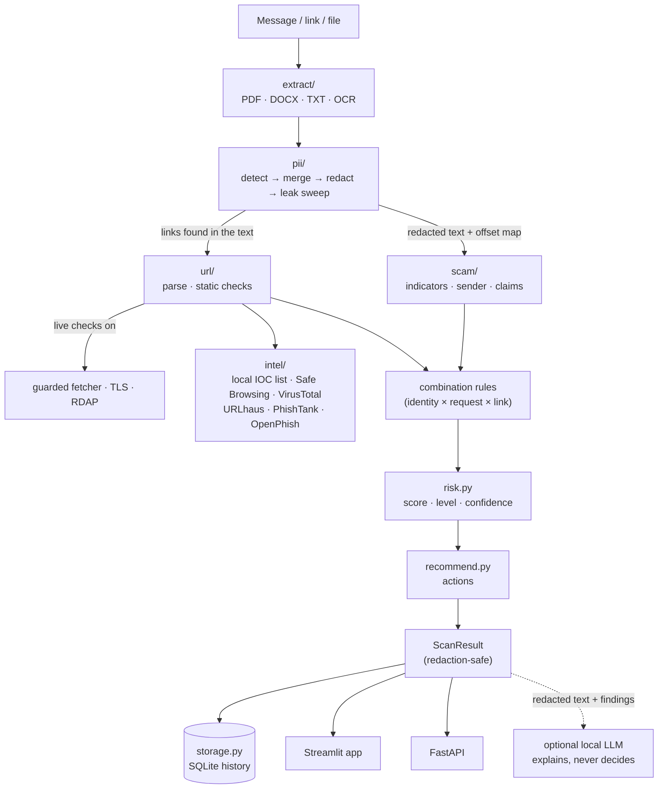
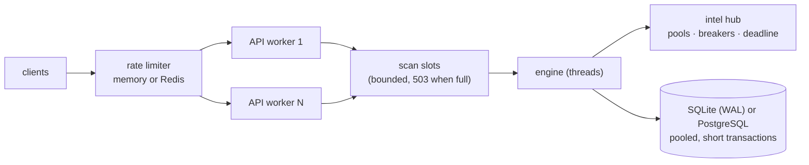

# Architecture

Verioax is one Python engine (`trustguard/`) with two front ends:
- a Streamlit web app (`app/`)
- a FastAPI REST API (`api/`)

The front ends contain no detection logic. They call the engine, either in-process or over HTTP, and render the
`ScanResult` it returns.

## One scan, end to end

`TrustGuardEngine._run` (in `engine.py`) runs these steps in order:

1. **Extract**: get plain text from the input, with a `locate(offset)` helper that maps text positions back to pages or
   paragraphs. The original text never leaves the process.
2. **PII**: run the detectors and merge overlapping hits by type priority. Replace each value with a typed placeholder.
   Then run the leak sweep:
   - re-run the detectors on the *redacted* output
   - search for every removed value with up to three separator characters inserted, which catches `98765-43210` after
     `9876543210` was removed

   Anything found is redacted in a second round. Anything still found after the last round sets the status to `blocked`.
3. **Scam & hoax**: indicator rules (English, Hinglish, Hindi), claimed-identity detection, sender analysis, claim
   extraction, hidden-character checks. Findings keep original-text offsets internally. Their public excerpts are cut
   from the redacted text.
4. **Links**: every link (also defanged and bare-domain forms) is analysed. The link engine:
   - runs the static checks on the address itself
   - removes personal-data query parameters before anything is sent anywhere
   - if live checks are on, fetches the page through the guarded fetcher, probes TLS and looks up the domain's
     registration date
   - asks the threat-intelligence hub about the cleaned URL
5. **Combination rules** look across engines. Example: *the message claims to be Parivahan* + *asks for payment* + *the
   link's domain is not Parivahan's* produces one critical finding attached to that link.
6. **Mitigations** subtract a few points for signs of a genuine message: every link on an official domain, a matching
   DLT header, the standard OTP advisory. They never override strong evidence.
7. **Risk**: one deterministic assessment for the scan and one per link. See [scoring.md](scoring.md).
8. **Recommendations** are triggered by specific findings, so each action explains itself.
9. **Result**: the `ScanResult` is stored, if history is on, and returned. The optional LLM explanation is added last, and
   only from the redacted text and the findings list.

## Data boundaries

| Data | Lives where | Leaves the engine? |
|---|---|---|
| Original text | Memory, for one scan. The web app keeps it in the browser session to show *your* text. | Never stored. The API never returns it. |
| Placeholder → value map | Memory (`RestrictedData`) | Never stored or returned |
| Redacted text | `ScanResult.redacted_text` | Stored and returned. This is the shareable version. |
| Finding excerpts | Cut from the redacted text | Stored and returned |
| PII findings | Type, placeholder, offsets, confidence, length, and a keyed fingerprint (HMAC with the installation secret in `data_dir/secret.key`) | Stored and returned, never the value. The fingerprint cannot be reversed without the key. |
| Links | Shown defanged. Personal-data query parameters are removed before any lookup. | The cleaned URL goes to the threat-intel services you enabled |
| API keys | `SecretStr` in `Settings` | Never logged, returned or shown |
| Passwords | Salted scrypt hashes in the accounts database | Never stored in plain text, never shown |
| Activity log | Only `login`, `scan` and `feedback`: account id, username, role, time; for a scan its type, verdict and scan id; for feedback its category and reference | Moderators only. No message contents, links, file names, IP addresses or personal data. Rows older than 180 days are deleted. |
| Security events | Failed sign-ins, wrong PINs and lockouts: failed-attempt counters on the account, sign-up PIN failures in a separate `security_events` table | Never shown in the activity log; used only for brute-force protection |
| Uploaded files and apps | Memory, for one scan. APKs are read in memory and never written to disk, installed, run or sent anywhere | Only the SHA-256 and the static-analysis report are stored |
| Metrics | Counts, latencies, route templates, scan types, verdict levels, provider names, exception class names | `/metrics` and `/v1/ops/stats` (token required); never content, links, accounts or keys |
| Feedback | Redacted by the PII engine before it is stored | The consumer who sent it and moderators |

The web app can highlight the original text in place because it holds that text in the browser session and the result
carries offsets. No raw value is ever sent back from the engine to do this.

## The LLM boundary

The design rule is that **the model explains and never decides**. The model only ever sees:

- the redacted text
- the list of findings
- the verdict that `risk.py` already computed

It never sees page content, which can carry instructions aimed at AI models. The page inspector looks for exactly that
kind of hidden text and flags it.

Its output is validated before display:
- no URLs or phone numbers in the explanation
- no reassurance on a HIGH or CRITICAL verdict

If validation fails, the explanation is dropped. A model that is missing or misbehaving changes nothing about the
verdict.

## The guarded fetcher (`url/network.py`)

Visiting attacker-chosen URLs from a server is a classic SSRF risk. Each hop is checked as follows:

- Scheme `http`/`https` and port 80/443 only.
- The host is resolved, and **every** returned address must be globally routable. Blocked: private, loopback,
  link-local, CGNAT, multicast, reserved, IPv4-mapped IPv6, and integer or hex IP spellings.
- The HTTP connection is **pinned** to the address that was validated. `GuardedBackend` overrides
  `httpcore.connect_tcp`, so a DNS answer that changes between the check and the connection (rebinding) cannot redirect
  it.
- Redirects are followed manually (at most 5), and each new location goes through the same checks.
- The body is capped at 1.5 MB. APKs and other binaries are recognised by content type and not downloaded. JavaScript is
  never executed.

## Front ends

- `app/client.py` has two clients with the same interface:
  - `LocalClient` wraps a `TrustGuardEngine`
  - `APIClient` calls the REST API with the bearer token
  
  `make_client()` picks one based on `TRUSTGUARD_API_URL`.
- `app/results.py` renders a `ScanResult`: verdict panel, actions, overview tiles and tabs (findings, links, personal
  data, original vs redacted, report).
- `api/main.py`:
  - bearer-token auth. The only exemption is a direct call from the same machine, when no token is configured and no
    proxy header is present.
  - `X-Verioax-Owner` honoured only on authenticated requests
  - per-client rate limits on scans, files and all `/v1` routes, so live checks can't be abused as an open proxy
  - size limits before processing
  - `Idempotency-Key` replay
  - security headers
  - generic error messages that never echo input back (validation errors included)

## Concurrency, storage and limits

- **Bounded work.** FastAPI runs the synchronous scan routes in its thread pool, so the event loop never blocks. Inside,
  each engine allows `VERIOAX_MAX_CONCURRENT_SCANS` scans and `VERIOAX_MAX_CONCURRENT_FILE_SCANS` file scans at once. A
  request that can't get a slot within `VERIOAX_SCAN_QUEUE_TIMEOUT_S` gets HTTP 503 with `Retry-After`; it never queues
  without limit. Threat-intelligence calls run on one bounded executor (16 threads), with at most 4 calls per provider.
- **Database layer** (`trustguard/db.py`):
  - **SQLite:** one connection per thread, WAL, `busy_timeout`, `synchronous=NORMAL`. Short transactions, and unique
    constraints instead of read-then-write checks.
  - **PostgreSQL:** `psycopg` 3 with a connection pool.
  - **Migrations:** versioned per component in `schema_migrations`. A SQLite file is copied before it is migrated.
  - **Idempotency:** scan ids and the `(event, ref)` key of the activity log are unique, and inserts use
    `ON CONFLICT DO NOTHING`. Retries and Streamlit reruns therefore can't create duplicates.
- **Rate limits** (`trustguard/ratelimit.py`): a sliding window. In memory it is bounded with LRU; in Redis it is shared
  across workers, falls back to memory when Redis is down, and stores hashed keys. The client address comes from
  `X-Forwarded-For` only behind the proxies listed in `VERIOAX_TRUSTED_PROXIES`.
- **Observability** (`trustguard/metrics.py`): request and scan counters, p50, p95 and p99 latencies, rejections,
  database errors, provider outcomes and process CPU and memory, as Prometheus text and JSON.

## Android apps (`extract/apk.py`, `appscan.py`)

An upload is recognised as an app by its content: a ZIP with `AndroidManifest.xml` and `classes.dex`. It is then:

1. Opened **in memory**, with limits:
   - 50 MB file
   - 40,000 entries
   - 1 GB of declared uncompressed data
   - a 250:1 compression ratio per member
   - per-part size caps
   - a 25-second time budget

   Path-traversal names, duplicate entries and members that inflate past their declared size are reported, and the
   offending member is not read.
2. Parsed:
   - the binary manifest, resolving labels through `resources.arsc`
   - the v1 PKCS#7 and the v2/v3 signing-block certificates, read with `cryptography` (signatures are not verified)
   - DEX string tables
   - native library names
   - packer signatures
3. Turned into findings by `appscan.py`. They are combinations rather than single permissions: OTP theft, overlay plus
   accessibility, a bank name on a sideloaded app, a test-key signature, a hidden launcher icon, and a data drop-off
   address in the code.

The app is never written to disk, installed or executed, and no part of it is uploaded. If the manifest can't be parsed,
the verdict is INCONCLUSIVE with the reason, never LOW.

## Accounts and roles

`trustguard/accounts.py` holds accounts, the activity log and feedback in their own database: `accounts.sqlite`, or
the shared PostgreSQL database. The Streamlit app uses it directly, also when scans go through the separate API.

- **The activity log has three events.**
  - `login` is written once per successful sign-in.
  - `scan` is written once per completed scan, keyed by the scan id, so a rerun or a retry can't add a second row.
  - `feedback` is written once per submitted item, keyed by its reference.

  `_record()` refuses any other event type. Pages, navigation, sign-out, sign-up, password changes, failed sign-ins,
  wrong PINs, lockouts and moderator actions write nothing to it. The brute-force counters live on the account and in
  `security_events`.

- **Two roles.** A *consumer* scans things and sees only their own history. A *moderator* also gets the moderation
  pages (overview, accounts, activity log, consumer feedback) and the platform-wide pages (threat intelligence,
  analytics, settings). `app/streamlit_app.py` builds a different navigation for each role, and every page checks the
  role again with `auth.require()`, so a URL typed by hand can't open a moderator page.
- **The moderator PIN** comes from `VERIOAX_MODERATOR_PIN` (`.env` or the host's secrets) and is never in the code. It
  must be exactly 6 digits, otherwise moderator access is switched off. It is asked at sign-up and at every sign-in.
- **Passwords** use `hashlib.scrypt` (N = 2^14, r = 8, p = 5) with a 16-byte salt and a constant-time comparison. An
  unknown username is checked against a dummy hash, so the response time doesn't reveal which accounts exist, and every
  sign-in failure shows the same message.
- **Lockouts.** Five wrong passwords or PINs lock an account for 15 minutes. Ten wrong PINs at sign-up within 15 minutes
  pause moderator sign-up for everyone, which makes guessing the PIN impractical.
- **Sessions** last one browser tab and end after 60 minutes without activity. The account is re-read on every page,
  so a suspension takes effect at once.
- **Scan ownership.** Every stored scan has an `owner_id`. The app wraps the engine client in a `ScopedClient` that
  passes the signed-in account to every call. Moderator pages that need everyone's scans use `client().everyone`. The
  API takes the owner in the `X-Verioax-Owner` header, and honours it only on authenticated requests. When the API runs
  separately, set `TRUSTGUARD_API_TOKEN` so that only the web app can call it.
- **What moderators see.** Traffic, the activity log and account status, never the contents of a consumer's scans. A
  consumer can attach one of their scans to feedback ("Report a wrong result"); only that scan's redacted result is
  then shown to moderators.

## Extending it

| To add | Edit |
|---|---|
| A scam indicator | `trustguard/scam/indicators.py`: add an `Indicator` (patterns, category, severity, strength, explanation, action), then add a message to `data/eval/messages.jsonl` and run `python -m trustguard.evaluation` |
| An organisation people impersonate | `trustguard/brands.py`: add an `Entity` with aliases, official domains and how to verify |
| A pattern across engines | `combine()` in `trustguard/scam/analyzer.py` |
| A PII type | a recogniser in `trustguard/pii/recognizers.py`, plus a validator if the type has a checksum, and a priority/label in `detector.py` |
| A threat-intel source | a provider class in `trustguard/intel/providers.py` (return `IntelResult` with an honest status), registered in `IntelHub` |
| Known scam domains | `data/iocs/*.txt` (one per line, defanged is fine), or the Threat intelligence page |
